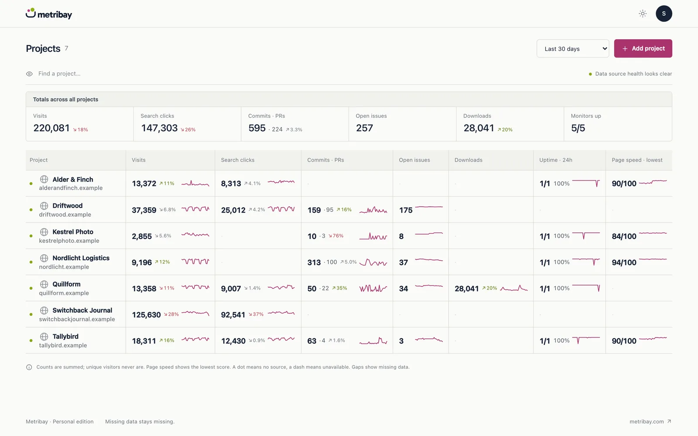
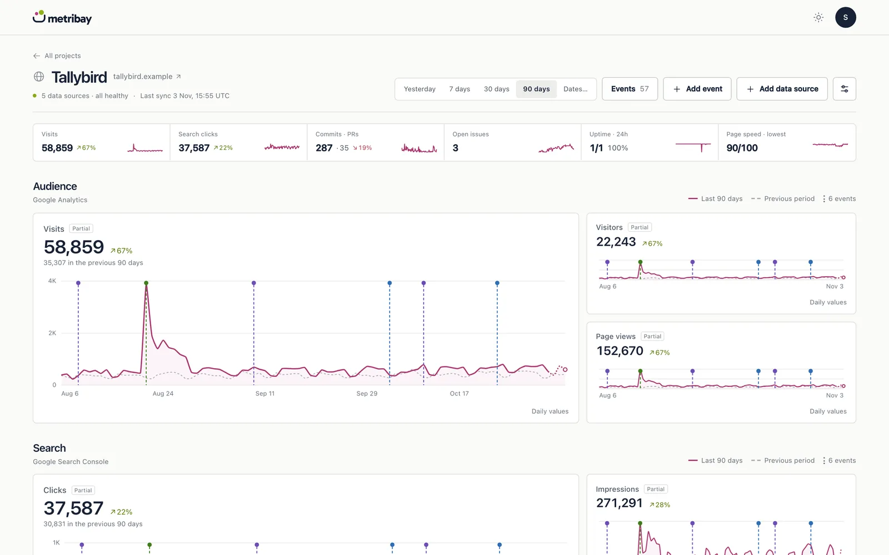
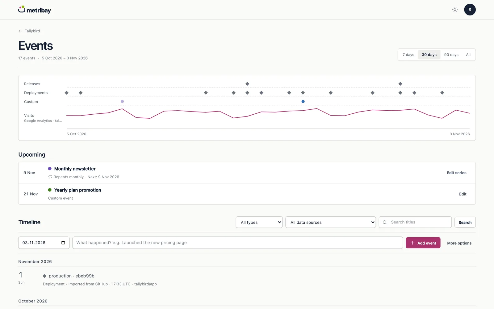

# Metribay

One dashboard for every project you run. Traffic, search, commits, downloads, page speed and uptime, side by side, on your own server.



Metribay doesn't replace your analytics, Search Console or uptime monitor. It reads from them on a schedule, stores what they report and shows it in one place. Opening the dashboard never calls a provider.

This is the self-hosted edition. It's free and open source under Apache-2.0. One person, one installation, no limits on projects or data sources. [Metribay Cloud](https://metribay.com) is the hosted version, for people who'd rather not run a server or want to work with a team.

## What it does

**The overview is one row per project.** Visits, search clicks, commits and pull requests, open issues, downloads, release downloads and uptime, with a trend line and the change against the previous period. Projects that need attention come first.

**Each project gets its own page.** Open **Overview** for recent uptime incidents and drops in Google Search Console clicks. **All metrics** is the default: fold chart groups and inspect daily values. **Search**, **Development and Issues** and **Revenue** open those groups when the project has them, and a **Custom view** can save a mix of groups in this browser. Top search queries show what people clicked, where you rank and where you're close. [Project page details](docs/PROJECT_PAGE.md)



**Events explain the spikes.** Add a launch, a pricing change or a migration. GitHub releases and deployments come in on their own. They show up as markers on every chart and on a timeline of their own.



**It's honest about gaps.** A missing day stays missing, never zero. Daily unique visitors are never added up into a fake period total. Provider timezones, provisional dates and source health stay visible.

The app speaks twelve languages: English, German, Bulgarian, Czech, Spanish, French, Italian, Dutch, Polish, Slovak, Slovenian and Serbian.

## Data sources

| Provider | What Metribay reads | You need |
|---|---|---|
| Umami | Visits, visitors, page views | Your Umami URL and a login |
| Plausible | Visits, visitors, page views | A Stats API key and the site domain. Plausible Cloud or a public self-hosted server |
| Matomo | Visits, visitors, page views | An auth token, the Matomo URL and the numeric site ID. Period visitor totals stay unknown |
| Google Analytics 4 | Visits, visitors, page views | A service account, or your own Google OAuth app |
| Google Search Console | Clicks, impressions, top queries | A service account, or your own Google OAuth app |
| Bing Webmaster Tools | Clicks, impressions, indexed pages, top queries | An API key |
| GitHub | Commits, merged pull requests, lines changed, open issues, releases, deployments | A token, or your own GitHub App |
| GitHub releases | Total release asset downloads | Nothing for a public repository; an optional token for a private one |
| Azure DevOps | Commits, completed pull requests, pipeline runs, open bugs, deployments | A personal access token for one organization |
| WordPress.org | Plugin downloads | Nothing |
| PageSpeed Insights | Lighthouse scores and real-user Core Web Vitals | Your own Google API key |
| UptimeRobot | Monitor status, uptime, response time | A read-only API key |

Everything uses your own credentials. Nothing goes through a Metribay server. Credentials are encrypted with your `APP_KEY` and bound to their provider. Details per provider: [docs/PROVIDERS.md](docs/PROVIDERS.md).

One limit to know about: Metribay only connects to public HTTPS endpoints. An Umami, Plausible or Matomo instance on your private network won't work.

## Try it in a minute

The Docker image has a fictional sample portfolio built in. Seven made-up projects, 400 days of history.

```sh
docker run --rm -p 127.0.0.1:8080:8080 -e APP_URL=http://127.0.0.1:8080 -e APP_KEY="$(docker run --rm ghcr.io/worbee/metribay key)" ghcr.io/worbee/metribay demo
```

Open http://127.0.0.1:8080: the demo signs you in, and nothing you click can change it. Or skip Docker and look around at https://demo.metribay.com.

## Install

### With Docker

```sh
git clone https://github.com/worbee/metribay.git && cd metribay
cp docker/.env.example docker/.env      # set APP_KEY and APP_URL
docker compose -f docker/compose.yaml up -d
docker compose -f docker/compose.yaml exec web php artisan metribay:install --email=you@example.com
```

That starts the web server, the queue worker and the scheduler, with SQLite in a volume. PostgreSQL, HTTPS behind a reverse proxy, backups and updates are in [docs/DOCKER.md](docs/DOCKER.md).

Compose uses the published image `ghcr.io/worbee/metribay`. To run your own build, `docker compose -f docker/compose.yaml build` first.

### Without Docker

You need PHP 8.5 or later with the cURL, DOM, OpenSSL, intl, mbstring and PDO SQLite or PostgreSQL extensions, and Composer 2. Node 24 only if you want to rebuild the frontend. The built assets are in `dist/`.

```sh
./scripts/setup.sh
cd standalone
php artisan metribay:install --email=you@example.com
php artisan serve --host=127.0.0.1 --port=8000
```

The install command asks for your password privately. It creates the only account; registration stays off.

Then keep two processes running, the queue worker and the scheduler:

```sh
php artisan queue:work --timeout=900
php artisan schedule:work
```

In production, run the worker under systemd or Supervisor, serve `standalone/public` over HTTPS, and use one cron entry for `php artisan schedule:run` instead of `schedule:work`. Collection runs every four hours, uptime every hour and a full history refresh once a week.

The full guide is at [metribay.com/docs/self-hosting](https://metribay.com/docs/self-hosting/). Operations notes, backups and the `APP_KEY` warning: [docs/OPERATIONS.md](docs/OPERATIONS.md).

## Usage statistics

Off by default. Nothing is sent and nobody is asked. If you want to help me improve Metribay, set `METRIBAY_ANALYTICS_ENABLED=true`: the app then asks each user, and sends anonymous usage statistics only after they agree. No names, emails, project data or URLs. What's sent and where: [docs/USAGE_ANALYTICS.md](docs/USAGE_ANALYTICS.md).

## How the repository is laid out

The root is the Composer package `metribay/core`: models, collectors, the dashboard UI and translations. `standalone/` is a small Laravel 13 application that runs it. Metribay Cloud and the desktop app use the same package.

| Path | What's there |
|---|---|
| `src/` | The package: connectors, jobs, services, Livewire components |
| `resources/`, `lang/`, `dist/` | Views, the twelve translations and the built CSS and JavaScript |
| `standalone/` | The self-hosted Laravel application |
| `docker/`, `Dockerfile` | The container image and Compose files |
| `docs/` | Metric rules, providers, operations, design notes |

## Development

```sh
cd standalone
composer test
composer analyse
vendor/bin/pint ../src ../tests ../database ../routes ../config app tests
cd ..
npm ci
npm test
npm run build
php standalone/artisan vendor:publish --tag=metribay-assets --force
```

Tests run on SQLite and PostgreSQL. CI runs both, plus static analysis, formatting, the JavaScript tests and a Docker build. Rebuild `dist/` with any UI change and commit it, so installs without Node work.

For realistic local data, `scripts/demo-database.sh` builds the sample portfolio into `standalone/database/demo.sqlite`. See [docs/DEMO_DATA.md](docs/DEMO_DATA.md).

Read [CONTRIBUTING.md](CONTRIBUTING.md) before opening a pull request. Security issues go to rob@worbee.com, not the issue tracker: [SECURITY.md](SECURITY.md).

## Embedding the package

Hosts with their own sign-in can set `metribay.account_enabled` to `false`. That hides the account pages and moves appearance settings under Settings → Appearance. The host stays responsible for turning off authentication routes it doesn't use.

## License

The source is Apache-2.0. See [LICENSE](LICENSE) and [NOTICE](NOTICE).

The Metribay name and logo belong to Worbee EOOD. The license covers the code, not the name or the logo. Bundled third-party code keeps its own license; see [dist/THIRD_PARTY_LICENSES.txt](dist/THIRD_PARTY_LICENSES.txt).
